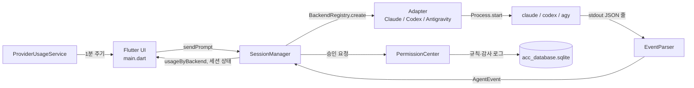

# Agent Control Center

여러 AI 코딩 에이전트 CLI(Antigravity `agy`, Claude Code `claude`, Codex `codex`) 세션을 한 화면에서 실행하고 관리하는 macOS 데스크톱 앱입니다.

A Flutter desktop app for macOS that runs and manages multiple AI coding agent CLI sessions (`agy`, `claude`, `codex`) in one window.

<p align="center">
  
  
</p>

## 만든 이유

<!-- TODO: 확인 필요 - 만든 동기 2~3문장 (작성자가 직접 기입) -->

## 주요 기능

- **다중 세션**: 백엔드(Antigravity, Claude Code, Codex)·모델·추론 강도·권한 모드를 세션마다 따로 정해 여러 세션을 병렬로 실행합니다. 세션은 작업 그룹으로 묶을 수 있습니다.
- **git worktree 격리**: Git 저장소에서 첫 프롬프트를 보내면 하위 세션이 별도 worktree에서 작업합니다. 같은 폴더를 동시에 수정하는 세션을 감지해 표시하고, 버튼으로 worktree 병합(`merge --no-ff`)과 정리를 수행합니다.
- **권한 승인**: 에이전트의 도구 실행 요청을 앱 대화상자로 받아 이번만/이 세션 동안/항상/거부로 응답합니다. 삭제·강제 푸시 같은 파괴적 명령은 항상 확인을 요구하고, 결정은 감사 로그로 남깁니다.
- **사용량 패널**: 세션·백엔드별 토큰 사용량, 프롬프트 캐시 적중률, 비용(Claude Code만), 공급자별 5시간·주간 한도와 컨텍스트 사용량을 보여줍니다.
- **인박스**: Gmail, Slack, Telegram Bot, macOS Mail.app, iMessage의 새 메시지를 감지해 3줄 요약과 OS 알림을 만듭니다.
- **세션 이어가기**: 세션 기록을 저장해 앱을 다시 켜도 복원하고, 하위 세션을 만들 때 상위 세션 기록을 압축해 넘깁니다.
- **스킬**: `~/.claude/skills`, `~/.codex/skills`, `~/.gemini/config/skills`의 `SKILL.md`를 읽어 목록으로 보여주고, 지정한 스킬을 바로 호출합니다.

## 데이터 출처

| 항목 | 출처(API) | 단위 | 갱신 주기 | 비고 |
|---|---|---|---|---|
| 에이전트 이벤트(메시지, 도구 호출, 승인 요청, 파일 변경) | 각 CLI의 stdout JSON 스트림 → `*EventParser.parseLine()` | 이벤트 | 이벤트 발생 시 | `Process.start`로 실행한 CLI의 출력을 한 줄씩 파싱 |
| 토큰 사용량 | Claude `result`, Codex `turn.completed`, agy 결과 이벤트의 `usage` → `TokenUsage` | 토큰 | 턴 종료 시 | CLI가 보고한 값을 세션·백엔드별로 합산 (`SessionManager.usageByBackend`) |
| 캐시 적중률 | Claude `cache_read_input_tokens`, Codex `cached_input_tokens`, agy `cache_read_tokens` | % | 턴 종료 시 | `cachedTokens / promptTokens` |
| 비용 | Claude `result` 이벤트의 `total_cost_usd` | USD | 턴 종료 시 | Claude Code만 제공. 값이 0이면 표시하지 않음 |
| 5시간·주간 한도 (Claude) | `~/.claude.json`의 `cachedUsageUtilization` | % | 1분 | Claude Code가 로컬에 남긴 캐시. 로그인 계정과 `accountUuid`가 다르면 표시하지 않음 |
| 5시간·주간 한도, 컨텍스트 (Codex) | `~/.codex/sessions/YYYY/MM/DD/*.jsonl`의 `token_count` 이벤트(`rate_limits`, `model_context_window`) | %, 토큰 | 1분 | 최근 세션 로그에 기록된 마지막 값 |
| 한도 (Antigravity) | `agy -p /usage --output-format json` 실행 결과 | % | 1분 | `remainingFraction`을 사용률로 변환 |
| 인박스 (Gmail / Slack / Telegram) | Gmail REST API, Slack `conversations.history`, Telegram `getUpdates` | 메시지 | 30초 | 권한 센터에서 허용하고 키체인에 저장한 읽기 전용 토큰 사용 |
| 인박스 (Mail.app) | `osascript`(AppleScript)로 읽지 않은 메일 조회 | 메시지 | 30초 | Mail이 꺼져 있으면 조회하지 않음 |
| 인박스 (iMessage) | `sqlite3`로 `~/Library/Messages/chat.db` 읽기 | 메시지 | 30초 + 파일 변경 감시 | `chat.db`, `chat.db-wal` 변경 시 즉시 조회 |

한도 정보는 `lib/services/provider_usage_service.dart`의 `ProviderUsageService.load()`가 세 공급자를 `Future.wait`로 동시에 읽고, `lib/main.dart`의 `Timer.periodic(const Duration(minutes: 1))`이 주기적으로 호출합니다.

## 설계 포인트

### 실행 → 파싱 → 집계 → 표시 흐름



- **어댑터 계층**: 모든 백엔드는 `AgentBackend` 인터페이스(`start`, `send`, `respondToApproval`, `respondToQuestion`, `interrupt`, `resume`, `dispose`)를 구현합니다. `BackendRegistry`에 빌더를 등록하는 방식이라 백엔드를 추가할 때 세션 관리 코드를 바꾸지 않습니다. 프로세스 실행은 `ProcessSpawner`로 주입받아 테스트에서 가짜 프로세스로 대체합니다.
- **백엔드별 승인 경로**:
  - Claude Code: `--permission-prompt-tool stdio`로 권한 요청을 stdin/stdout으로 주고받습니다.
  - Codex: 프롬프트마다 `codex exec --json`을 실행합니다. 실행 중 승인을 물을 수 없어 수동·계획 모드에서는 `-s read-only`로 실행합니다.
  - Antigravity: 허용 규칙을 `--settings` JSON으로 넘기고, 루프백 HTTP 서버(`LocalHookBridgeServer`, `127.0.0.1` 임의 포트, `POST /approval`)로 승인 요청을 받습니다. 5분 안에 응답이 없으면 거부합니다.
- **파괴적 명령 판별**: `ApprovalRequestData.detectDestructive()`가 명령 문자열을 정규식으로 검사합니다(`rm`, `sudo`, `git push --force`, `git reset --hard`, `DROP TABLE` 등). 커밋 메시지처럼 실행되지 않는 따옴표 문자열은 빼고 검사합니다. 파괴적 작업은 "항상"이나 "이 세션 동안"으로 승인해도 "이번만"으로 낮춰 기록합니다.
- **worktree 흐름**: `_defaultWorktreeAllocator()`가 시스템 임시 폴더에 `acc_worktree_*`를 만들고 `git worktree add -b acc/...`로 브랜치를 만듭니다. `mergeSessionWorktree()`는 변경을 커밋하고 시작 브랜치로 `merge --no-ff` 하며, 실패하면 `merge --abort`로 되돌립니다. 시작 브랜치가 체크아웃돼 있지 않거나 세션이 실행 중이면 병합하지 않습니다.

### 앱 자체 부하를 줄이기 위한 결정

코드에 근거가 있는 항목만 적습니다.

- **Codex 로그 읽기 범위 제한**: 최근 7일 날짜 폴더만 보고, 그중 최근 8개 파일만 끝에서부터 읽습니다. 날짜 폴더가 모두 비었을 때만 전체를 재귀 탐색합니다.
- **외부 프로세스 시간 제한**: `agy /usage` 조회는 15초가 지나면 프로세스를 종료합니다.
- **불필요한 앱 실행 방지**: Mail.app 조회는 AppleScript에서 Mail이 실행 중인지 먼저 확인해, 폴링이 Mail을 띄우지 않게 합니다.
- **스캔당 처리량 제한**: 인박스는 한 번 스캔에 새 메시지를 최대 20개(`_maxNewPerScan`)까지 처리합니다.
- **폴링 + 파일 감시**: iMessage는 30초 폴링에 더해 `chat.db` 폴더 변경 이벤트로 조회합니다.
- **압축 호출 생략**: 1500자(`handoffCompressionThreshold`) 미만의 기록은 에이전트를 호출해 압축하지 않습니다. 복원한 세션은 실제로 이어갈 때만 컨텍스트를 준비합니다.
- **스레드**: 별도 `Isolate`는 쓰지 않습니다. 파일·프로세스·네트워크 I/O는 Dart 비동기 API로 메인 isolate의 이벤트 루프에서 처리합니다. 일부 호출(`Directory.listSync`, 설정 파일 동기 쓰기)은 동기 방식입니다.

### 값별 정확도와 한계

| 값 | 성격 | 한계 |
|---|---|---|
| 토큰·캐시·비용 | CLI가 보고한 값 | 백엔드마다 `input_tokens`에 캐시를 포함하는 방식이 달라 `promptTokens`를 따로 계산합니다. 비용은 Claude Code만 제공합니다. |
| Claude 한도 | Claude Code의 로컬 캐시 | Claude Code가 마지막으로 갱신한 시점의 값입니다. 공개 형식이 아니라 CLI 버전이 바뀌면 읽지 못할 수 있습니다. |
| Codex 한도·컨텍스트 | 최근 세션 로그의 마지막 기록 | Codex를 최근에 쓰지 않았으면 오래된 값이거나 "정보 없음"으로 표시됩니다. 로그 형식은 공개 규격이 아닙니다. |
| Antigravity 한도 | `agy /usage` 실행 결과 | 버킷 이름에 `week`, `7d`, `session`, `hour` 등이 들어 있는지로 5시간·주간을 구분하는 추정 방식입니다. |
| 인박스 요약 | 키워드 규칙 | 기본 요약(`_buildStructuredSummary`)은 모델을 호출하지 않고, 키워드로 긴급도를 정하고 본문 첫 줄을 잘라 보여줍니다. 요약 결과에 표시되는 모델명(`gemini-3-flash`)은 설정값이며 실제 호출 여부를 뜻하지 않습니다. |
| 자동 오케스트레이션 | 키워드 규칙 | `AgentOrchestrator.evaluatePrompt()`가 프롬프트의 키워드로 위임 대상 백엔드를 정합니다. |

## 앱 자체 오버헤드

<!-- TODO: 확인 필요 - 아래 측정값 전부 -->

| 항목 | 측정값 | 측정 환경 | 측정 방법 |
|---|---|---|---|
| CPU 사용률 (유휴) | TODO | TODO | Activity Monitor |
| CPU 사용률 (세션 실행 중) | TODO | TODO | Instruments Time Profiler |
| 메모리 사용량 | TODO | TODO | Activity Monitor / Instruments Allocations |
| 에너지 영향 | TODO | TODO | Activity Monitor 에너지 탭 |

측정 절차:

1. `flutter build macos --release`로 빌드한 앱을 실행하고, 측정 전 5분간 유휴 상태로 둡니다.
2. Activity Monitor의 CPU·메모리·에너지 탭에서 `agent_control_center` 프로세스 값을 10분간 관찰해 평균을 기록합니다. 자식 프로세스(`claude`, `codex`, `agy`)는 따로 기록합니다.
3. Xcode Instruments의 Time Profiler와 Allocations 템플릿으로 앱에 연결해, 유휴 상태와 세션 실행 상태를 각각 기록합니다.
4. 측정한 Mac 모델, 칩, macOS 버전, 실행 중인 세션 수를 "측정 환경"에 함께 적습니다.

## 설치 및 빌드

```bash
git clone https://github.com/keydisk/agent_control_center.git
```

```bash
cd agent_control_center && flutter pub get
```

실행:

```bash
flutter run -d macos
```

릴리스 빌드:

```bash
flutter build macos --release
```

테스트:

```bash
flutter test
```

사용할 에이전트 CLI(`agy`, `claude`, `codex`)는 따로 설치하고 로그인해 두어야 합니다. 앱은 `which <실행 파일>`로 설치 여부를 확인하고, CLI를 실행할 때 `PATH` 앞에 `~/.local/bin`, `/opt/homebrew/bin`, `/usr/local/bin`을 추가합니다.

<!-- TODO: 확인 필요 - 서명·공증된 배포 빌드 제공 여부 -->

## 요구 사항

- **macOS** 12.0 이상 (`MACOSX_DEPLOYMENT_TARGET = 12.0`)
- **칩**: <!-- TODO: 확인 필요 - Apple Silicon / Intel / Universal 빌드 확인 --> 확인 필요
- **Flutter** stable (Dart SDK `^3.13.3`). 개발 환경은 Flutter 3.47.4입니다.
- **외부 도구**: `git`, 사용할 에이전트 CLI. 인박스 기능은 macOS 기본 `osascript`, `sqlite3`를 사용합니다.
- **엔타이틀먼트**: App Sandbox 비활성화(`com.apple.security.app-sandbox = false`, 외부 CLI 실행과 홈 폴더 설정 파일 접근에 필요), `network.client`, `network.server`(로컬 승인 브리지)
- **macOS 권한** (해당 기능을 쓸 때만):
  - 알림: OS 알림 표시
  - 자동화(Apple Events) → Mail: Mail.app 인박스 (`NSAppleEventsUsageDescription`)
  - 전체 디스크 접근: iMessage `chat.db` 읽기
- 비공개 API나 `sudo`가 필요한 기능은 없습니다.

<!-- TODO: 확인 필요 - ios/android/linux/windows/web 폴더는 Flutter 기본 구성이며, 해당 플랫폼의 빌드·동작은 확인하지 않음 -->

## 저장 데이터

모든 데이터는 로컬에만 저장합니다.

| 위치 | 포맷 | 내용 | 보존 |
|---|---|---|---|
| `~/.agent_control_center/` 의 `settings.json`, `models.json`, `efforts.json`, `trusted_folders.json`, `workspace_groups.json`, `inbox_state.json`, `os_permissions.json` | JSON | 설정, 모델·강도 선택, 신뢰 폴더, 작업 그룹, 인박스 감지 위치, OS 권한 기록 | 덮어쓰기 |
| `~/.agent_control_center/workspace_groups_history.json` | JSON | 세션 스냅샷(대화·컨텍스트) | 저장 세션 최대 50개, 그룹당 스냅샷 10개 |
| `~/.agent_control_center/acc_database.sqlite` | SQLite (drift) | 권한 규칙, 권한 감사 로그 | 감사 로그 삭제 기능 없음 |
| OS 키체인 | `flutter_secure_storage` | 인박스 연동 토큰 등 비밀값 | 사용자가 삭제할 때까지 |

JSON 파일은 `writeJsonAtomically()`로 임시 파일에 쓴 뒤 이름을 바꿔, 쓰는 도중 앱이 종료돼도 기존 파일이 깨지지 않게 합니다.

## 알려진 한계와 앞으로 할 일

- 한도 정보는 각 CLI의 비공개 로컬 파일·출력 형식에 의존하므로 CLI 업데이트 후 표시되지 않을 수 있습니다.
- 인박스 요약과 자동 오케스트레이션은 키워드 규칙 기반입니다. 모델 요약은 `InboxService`의 `customSummarizer` 주입 지점만 있고 앱에 연결돼 있지 않습니다.
- 권한 센터의 OS 권한 항목은 macOS의 실제 권한(TCC) 상태를 조회하지 않고, 사용자가 앱에서 기록한 값을 사용합니다.
- Codex는 `exec` 방식이라 실행 중 승인을 받을 수 없습니다. `app-server` 방식 코드(`useAppServer`)는 있지만 기본으로 꺼져 있습니다.
- `LocalHookBridgeServer.writeAgyHookScript()`(agy PreToolUse 훅 스크립트 생성)는 현재 호출되지 않습니다.
- Slack 인박스 채널 ID 기본값이 `C01GENERAL`로 고정되어 있습니다.
- 파괴적 명령 판별은 명령 문자열 패턴 검사라 스크립트 내부의 삭제나 우회 표현은 감지하지 못합니다.
- 작업 그룹 파일은 전체를 다시 쓰므로 앱을 여러 개 동시에 실행하면 마지막 쓰기만 남습니다.
- 감사 로그는 정리 정책이 없어 계속 쌓입니다.

<!-- TODO: 확인 필요 - 앞으로 할 일(로드맵) 항목 -->

## 라이선스

[MIT](LICENSE)
